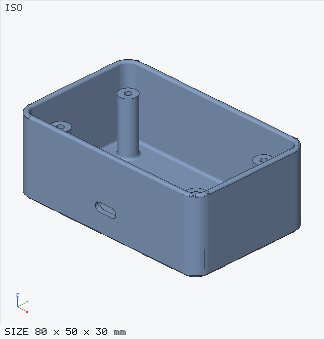
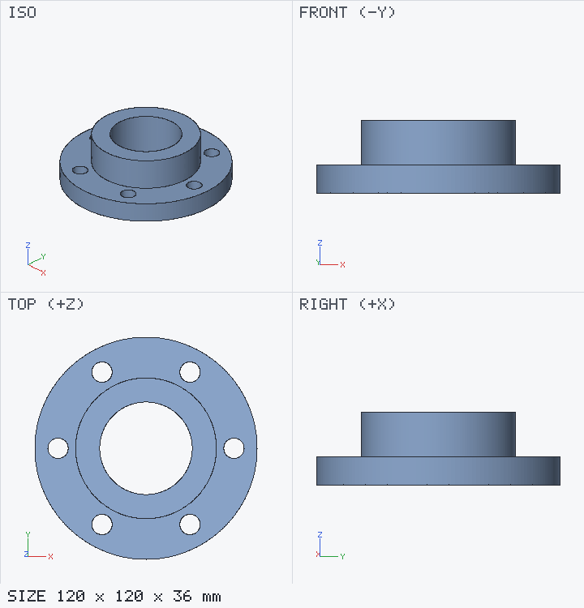
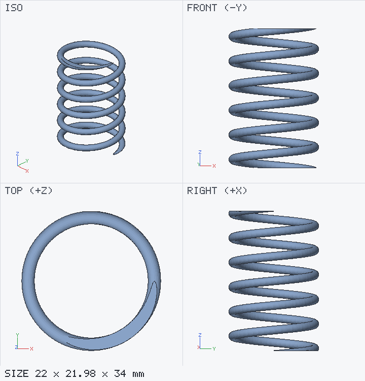
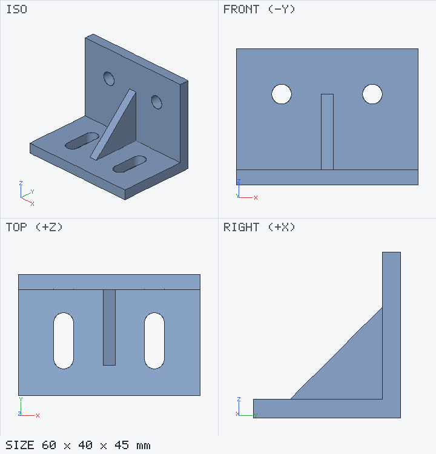

# LazyCAD

**Parametric, constraint-based 3D CAD that runs in your browser, and that Claude can drive with exact dimensions.**

LazyCAD is a small, dependency-light CAD system: sketch on planes or faces, constrain and dimension the
sketch, then build solids with extrude, revolve, sweep, loft, fillet, chamfer, shell, patterns and
booleans. Every number can be a formula of named parameters, so you can change one value and the whole
model follows.

The same geometry kernel runs in two places:

- **The browser app.** An interactive modeller with a 3D viewport, a sketcher, a feature timeline and
  measuring tools.
- **A headless CLI.** It builds models from short JavaScript *model scripts*, reports exact measurements,
  renders PNG previews and exports STL / OBJ / 3MF / DXF / SVG.

The two stay in sync. When a script is built, the open browser tab updates instantly, and edits made in
the browser are saved back to the same file. LazyCAD also ships as a **Claude skill**, so you can ask
Claude to *"design a 80 × 50 × 30 mm enclosure with 2 mm walls and four M2.5 screw bosses"*. Claude writes
the script, builds it, checks the measurements and the rendered views, and hands you the model in the app.

<p align="center">
  
</p>

| | | |
|---|---|---|
|  |  |  |
| Flange: revolve + patterned bolt holes | Spring: helix sweep, trimmed ends | Bracket: face sketches, slots, gusset |

## Features

**Sketching**
- Sketch on the XY / XZ / YZ planes, on datum planes (offset, angled, three-point, explicit) or directly
  on any face of the model.
- Drawing tools: line / polyline, rectangle, centre rectangle, circle, arc, regular polygon, slot,
  Bézier spline, point and construction geometry.
- Editing tools: trim, plus corner fillet / chamfer. When you round a corner, the original sharp corner
  is kept as a hidden reference, so the dimensions you already placed still hold.
- **Constraints:** coincident, horizontal, vertical, parallel, perpendicular, collinear, equal, tangent,
  concentric, midpoint, symmetric, point-on-curve and fix.
- **Dimensions:** distance, horizontal / vertical distance, length, radius, diameter and angle, either
  driving or reference-only. There are also free-form equations such as `len(l1) = 2*len(l2)`.
- The degrees of freedom are shown live, conflicting constraints are reported, and you can drag
  geometry while it stays constrained.
- Closed regions are detected automatically, including regions formed by crossing curves. Pick regions
  with a click, or combine them with union / subtract / intersect / xor / offset expressions.

**Solid features**
- **Extrude** one-sided, two-sided, symmetric or through all; along the normal, any axis, a tilted
  direction or a sketch line; with twist and taper.
- **Revolve**, **sweep** along sketch curves or a helix, and **loft** (smooth or ruled, with end
  tangency control).
- Primitives: box, cylinder, cone, sphere and torus.
- **Fillet and chamfer on 3D edges.** Click edges or select them by rule (all edges, edges at a
  height, edges parallel to an axis, inside or outside edges, the edge nearest a point). Inside edges get
  material added, and three filleted edges meeting at a corner get a spherical corner.
- **Shell** (hollow) with open faces, inward or outward.
- Linear and circular **patterns** of features or bodies, **mirror**, move / rotate, **boolean** and
  **split by plane**.
- Every solid feature can create a new body, or join, cut or intersect an existing one.

**Parametric workflow**
- Named parameters with formulas (`wall = 2`, `inner = width - 2*wall`, `1in`, `sqrt(a^2+b^2)`).
- A feature timeline with edit, suppress, reorder and delete, plus undo / redo. Any feature can also be
  edited as raw JSON.

**Measure and verify**
- Click two points (vertices snap) to get the distance, the x / y / z differences and the angle between
  faces.
- Per body: volume, surface area, bounding box, centroid, number of solids, closed cavities and genus.
- The CLI adds cross-sections, edge and face listings, and PNG renders (iso / front / top / right).

**Export**
- STL (binary / ASCII), OBJ and 3MF, rebuilt at a finer curve tolerance (0.002 mm by default).
- Sketches as DXF / SVG, with true arcs and circles.
- Save and open the `.cad.json` document.

## Quick start

Requires **Node.js 18+**.

```bash
git clone https://github.com/haroonalisa/lazyCAD.git lazyCAD
cd lazyCAD
npm install
npm start                      # → http://localhost:8777
```

Open http://localhost:8777. Then:
1. Pick an example from the right-hand panel, or press **Sketch**, click the XY plane and draw a
   rectangle.
2. Press **Finish**, then **Extrude**.

Build a model from the command line (the open browser tab updates live):

```bash
node cli/cad.mjs build examples/enclosure.js --png preview.png --3mf enclosure.3mf
node cli/cad.mjs set wall=3 H=40          # change parameters and rebuild
node cli/cad.mjs info                     # parameters, timeline, sketch status, exact measurements
npm test                                  # run the test suite
```

A model script is plain JavaScript:

```js
export default (cad) => {
  cad.params({ w: 60, d: 40, t: 5, hole: 6.5 });
  const s = cad.sketch('XY');
  const r = s.rect([0, 0], [60, 40]);
  s.fix(r.bl, [0, 0]);
  s.length(r.bottom, 'w');
  s.length(r.left, 'd');
  s.filletAll(r, 4);                        // rounded corners
  const h = s.circle([30, 20], 3.25);
  s.diameter(h, 'hole');
  cad.extrude(s, { id: 'plate', distance: 't' });
  cad.chamfer({ body: 'plate', edges: { z: 't' }, distance: 0.5 });
};
```

## Use it as a Claude skill

Link the repository into your Claude skills folder and install the dependencies:

```bash
npm install
ln -s "$PWD" ~/.claude/skills/lazycad
```

Claude will now pick up the skill when you ask it to design, modify or export a part. See
[docs/claude-skill.md](docs/claude-skill.md) for how it works.

## Documentation

| Document | Contents |
|---|---|
| [User guide](docs/user-guide.md) | The browser app: layout, sketching, constraints, features, picking, measuring, exporting, shortcuts |
| [Scripting guide](docs/scripting-guide.md) | Writing model scripts step by step, with patterns for common parts |
| [API reference](docs/reference.md) | Every builder method, sketch entity, constraint, feature option, plane spec, profile expression, CLI command and the JSON format |
| [Claude skill](docs/claude-skill.md) | Installing the skill, the build-and-verify loop, live sync, tips for prompting |
| [Architecture](docs/architecture.md) | How it works: solver, region detection, kernel, fillet / shell algorithms, renderer, design decisions and limits |
| [Contributing](CONTRIBUTING.md) | Development setup, tests, code style |

## Accuracy and limits

LazyCAD models solids as exact triangle meshes using the
[manifold](https://github.com/elalish/manifold) geometry library, which gives very robust booleans.
- **What is exact:** planar faces, straight edges and every dimension you enter.
- **Curved surfaces** are faceted to within a chord tolerance: 0.01 mm while modelling and 0.002 mm on
  export, configurable per document.
- **Circles** always include their quadrant points, so diameters and bounding boxes of round features
  measure exactly.
- **No STEP / NURBS export.** Because the kernel is mesh-based, there is no exact-curve export. Use
  STL / 3MF / OBJ for 3D and DXF / SVG (true arcs) for 2D.

## License

[MIT](LICENSE)
